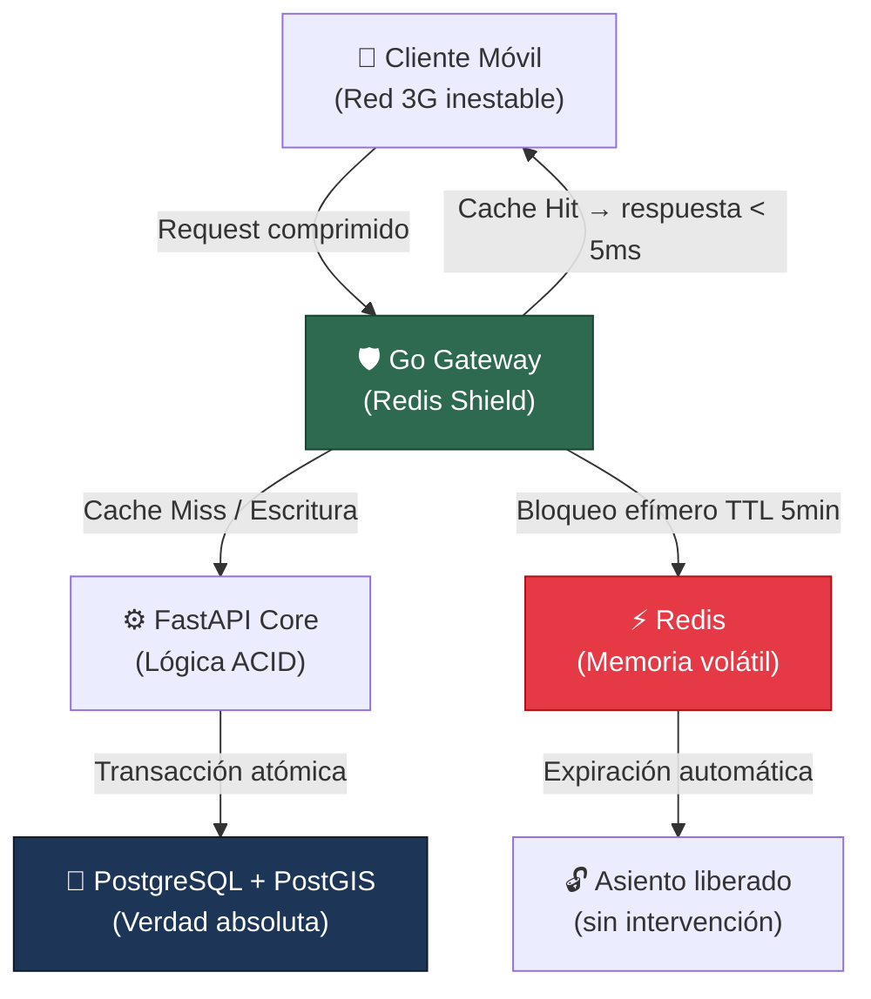
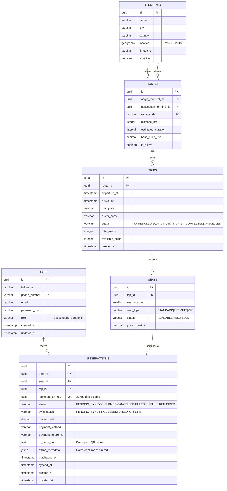
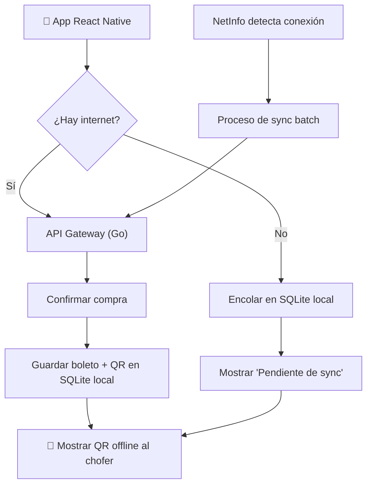

# Plataforma de Reserva de Pasajes — Ultra-Resiliente para Infraestructura del Tercer Mundo

## Filosofía Arquitectónica: El Enfoque Híbrido como Escudo Anti-Colapso

Antes de entrar en detalles técnicos, es fundamental entender **por qué** este diseño híbrido (PostgreSQL + Redis) es la única estrategia viable para un entorno donde la infraestructura es hostil.

### El Problema Real

En entornos de baja conectividad, la cadena de fallos típica es:

```
Usuario en 3G inestable → Timeout del request → Cliente reintenta →
Doble petición al servidor → Doble cobro o asiento fantasma →
Pérdida de confianza del usuario → Muerte del producto
```

### Cómo el Modelo Híbrido lo Resuelve



| Capa | Tecnología | Rol | Qué pasa si se cae |
|------|-----------|-----|---------------------|
| **Shield** | Go + Redis | Absorbe 90% de lecturas, bloqueos temporales | El sistema sigue funcionando, solo más lento (bypass a PostgreSQL) |
| **Core** | FastAPI + PostgreSQL | Procesa transacciones finales, garantía ACID | Redis mantiene bloqueos activos, el cliente reintenta con idempotency_key |
| **Persistencia** | PostgreSQL + PostGIS | Fuente de verdad, jamás pierde datos | Los datos en Redis expiran solos, no hay inconsistencia huérfana |
| **Cliente** | React Native (Offline-First) | Almacena boletos localmente | El usuario muestra su QR sin internet |

**Principio clave**: Redis NUNCA es fuente de verdad. Si Redis muere, se pierde caché (reconstruible) y bloqueos temporales (expiran solos). PostgreSQL NUNCA pierde una venta confirmada.

---

## Estructura de Directorios del Proyecto

```
busbud-copia/
├── docker-compose.yml
├── .env.example
├── README.md
│
├── gateway/                     # Go — API Gateway + Redis Shield
│   ├── Dockerfile
│   ├── go.mod
│   ├── go.sum
│   ├── main.go
│   ├── config/
│   │   └── config.go
│   ├── handlers/
│   │   ├── search.go            # Cache-aside search
│   │   └── hold_seat.go         # Distributed lock
│   ├── middleware/
│   │   ├── compression.go
│   │   └── ratelimit.go
│   ├── redis/
│   │   └── client.go
│   └── models/
│       └── responses.go
│
├── core/                        # Python FastAPI — Backend Core
│   ├── Dockerfile
│   ├── requirements.txt
│   ├── alembic.ini
│   ├── alembic/
│   │   ├── env.py
│   │   └── versions/
│   ├── app/
│   │   ├── __init__.py
│   │   ├── main.py
│   │   ├── config.py
│   │   ├── database.py
│   │   ├── exceptions.py        # Global exception handlers
│   │   ├── models/              # SQLAlchemy ORM
│   │   │   ├── __init__.py
│   │   │   ├── terminal.py
│   │   │   ├── route.py
│   │   │   ├── trip.py
│   │   │   ├── seat.py
│   │   │   ├── reservation.py
│   │   │   └── user.py
│   │   ├── schemas/             # Pydantic v2
│   │   │   ├── __init__.py
│   │   │   ├── reservation.py
│   │   │   └── trip.py
│   │   ├── services/            # Business logic
│   │   │   ├── __init__.py
│   │   │   └── reservation_service.py
│   │   └── routers/
│   │       ├── __init__.py
│   │       ├── reservations.py
│   │       └── trips.py
│
├── db/                          # PostgreSQL init scripts
│   ├── 00_extensions.sql
│   ├── 01_schema.sql
│   └── 02_seed.sql
│
├── redis/                       # Redis configuration
│   └── redis.conf
│
├── frontend/                    # React Admin Panel (Phase 3)
│   └── .gitkeep
│
└── mobile/                      # React Native App (Phase 3)
    └── .gitkeep
```

---

## FASE 0: Configuración Multi-Capa y Modelado de Datos Híbrido

### 0.1 — Docker Compose: Orquestación de Servicios

> [!IMPORTANT]
> Todos los servicios incluyen `restart: unless-stopped` y health checks para auto-recuperación tras cortes de energía. PostgreSQL usa `wal_level=replica` para durabilidad máxima.

**Servicios a crear:**

| Servicio | Puerto | Dependencias | Volumen persistente |
|----------|--------|-------------|---------------------|
| `postgres` | 5432 | — | `pgdata` |
| `redis` | 6379 | — | No (efímero por diseño) |
| `core` (FastAPI) | 8000 | postgres | — |
| `gateway` (Go) | 8080 | redis, core | — |

**Decisiones de diseño:**
- Redis **sin volumen persistente** a propósito: si el servidor se reinicia, Redis arranca vacío y se repuebla desde PostgreSQL bajo demanda (cache-aside). Esto es una feature, no un bug.
- PostgreSQL con `fsync=on` y `synchronous_commit=on` para garantizar que ninguna venta confirmada se pierda, incluso ante corte de luz abrupto.
- Healthchecks nativos de Docker para que los servicios dependientes no arranquen hasta que la DB esté lista.

---

### 0.2 — Modelado Relacional (PostgreSQL + PostGIS)

#### Diagrama Entidad-Relación



> [!WARNING]
> **Campos de resiliencia obligatorios en `RESERVATIONS`:**
> - `idempotency_key` (UNIQUE): El cliente genera un UUID v4 antes de intentar la compra. Si la red corta y el cliente reintenta, PostgreSQL rechaza el INSERT duplicado con un ON CONFLICT, devolviendo la reserva existente en vez de crear una segunda.
> - `sync_status`: Permite que reservas hechas offline en el móvil se marquen como `PENDING_SYNC` y se procesen cuando hay conexión.
> - `qr_code_data`: El QR se genera en el servidor y se almacena en la reserva para que el cliente lo descargue una sola vez y lo muestre offline.

---

### 0.3 — Modelado No Relacional Efímero (Redis)

#### Nomenclatura de Keys

| Patrón de Key | Tipo Redis | TTL | Propósito |
|---------------|-----------|-----|-----------|
| `search:{origin}:{dest}:{date}` | STRING (JSON comprimido) | 120s | Cache de resultados de búsqueda |
| `trip:{trip_id}:seats` | HASH | 300s | Mapa de disponibilidad de asientos |
| `hold:{trip_id}:seat:{seat_num}` | STRING (user_id) | 300s (5 min) | Bloqueo temporal de asiento |
| `user:{user_id}:active_holds` | SET | 600s | Asientos retenidos por un usuario |
| `rate:{ip}` | STRING (counter) | 60s | Rate limiting por IP |
| `trip:{trip_id}:meta` | HASH | 600s | Metadata del viaje cacheada |

#### Políticas de Expiración

```
┌─────────────────────────────────────────────────────────────┐
│                    CICLO DE VIDA REDIS                       │
├─────────────────────────────────────────────────────────────┤
│                                                             │
│  BÚSQUEDA (TTL: 2 min)                                     │
│  ┌──────┐  hit   ┌──────────┐                              │
│  │Client├───────>│ Redis    │──> Respuesta instantánea      │
│  └──┬───┘  miss  └──────────┘                              │
│     │            ┌──────────┐  ┌──────────┐                │
│     └───────────>│PostgreSQL├─>│Redis SET │──> Respuesta    │
│                  └──────────┘  │ TTL=120s │                │
│                                └──────────┘                │
│                                                             │
│  BLOQUEO DE ASIENTO (TTL: 5 min)                           │
│  ┌──────┐ hold   ┌──────────┐                              │
│  │Client├───────>│Redis SET │                              │
│  └──────┘        │  NX + EX │──> "Asiento bloqueado 5 min" │
│                  │ TTL=300s │                              │
│                  └─────┬────┘                              │
│                        │ expira                             │
│                        v                                    │
│               🔓 Asiento libre automáticamente              │
│                  (sin tocar PostgreSQL)                     │
│                                                             │
└─────────────────────────────────────────────────────────────┘
```

> [!NOTE]
> Redis usa `maxmemory-policy: allkeys-lru` — cuando la RAM se llena, descarta automáticamente las keys menos usadas. Esto es seguro porque todo dato en Redis es reconstruible desde PostgreSQL.

---

## FASE 1: Núcleo Robusto — FastAPI + PostgreSQL ACID

### 1.1 — Estructura del Proyecto FastAPI

Arquitectura modular con separación estricta de responsabilidades:

- **`models/`**: Modelos SQLAlchemy con mixins de auditoría (`created_at`, `updated_at`)
- **`schemas/`**: Modelos Pydantic v2 con `model_config = ConfigDict(strict=True)` para validación severa
- **`services/`**: Lógica de negocio pura, inyección de dependencias via `Depends()`
- **`routers/`**: Endpoints delgados que solo validan y delegan

### 1.2 — Servicio Transaccional de Reservas

**Garantía ACID implementada con:**

1. **Aislamiento `SERIALIZABLE`**: La transacción de compra usa `SELECT ... FOR UPDATE NOWAIT` sobre el asiento. Si dos requests llegan al mismo milisegundo, la segunda recibe un error inmediato (no espera) y el cliente reintenta.
2. **Idempotencia por diseño**: `INSERT ... ON CONFLICT (idempotency_key) DO NOTHING RETURNING *`. Si el mismo request llega 3 veces, solo la primera crea la reserva; las demás devuelven la reserva existente.
3. **Rollback automático**: Cualquier excepción dentro del `async with session.begin()` hace rollback completo.

```python
# Pseudocódigo del flujo crítico
async def confirm_reservation(session, idempotency_key, seat_id, user_id):
    # 1. Verificar idempotencia
    existing = await get_by_idempotency_key(session, idempotency_key)
    if existing:
        return existing  # Mismo request, misma respuesta

    # 2. Bloquear asiento con FOR UPDATE NOWAIT
    seat = await lock_seat_for_update(session, seat_id)  # Raises si ya bloqueado
    if seat.status != "AVAILABLE":
        raise SeatNotAvailableError()

    # 3. Crear reserva + actualizar asiento atómicamente
    seat.status = "SOLD"
    reservation = Reservation(
        idempotency_key=idempotency_key,
        seat_id=seat_id,
        user_id=user_id,
        status="CONFIRMED",
        sync_status="PROCESSED",
    )
    session.add(reservation)
    # commit automático al salir del context manager
    return reservation
```

### 1.3 — Manejo Global de Errores

Interceptores registrados en FastAPI para cada tipo de excepción:

| Excepción | HTTP Status | Respuesta JSON |
|-----------|-------------|----------------|
| `ValidationError` (Pydantic) | 422 | `{error: "VALIDATION_ERROR", details: [...]}` |
| `SeatNotAvailableError` | 409 | `{error: "SEAT_CONFLICT", message: "..."}` |
| `IdempotencyConflictError` | 200 | Devuelve la reserva existente (no es error) |
| `DBAPIError` (deadlock/timeout) | 503 | `{error: "DB_BUSY", retry_after: 2}` |
| `Exception` (catch-all) | 500 | `{error: "INTERNAL", request_id: "..."}` |

> [!IMPORTANT]
> El catch-all de 500 **logea** el traceback completo internamente pero **nunca** lo expone al cliente. Siempre devuelve un JSON limpio con un `request_id` para debugging.

---

## FASE 2: Capa de Alto Rendimiento — Go + Redis Shield

### 2.1 — Servidor API en Go

Router usando `chi` (ligero, stdlib-compatible). Dos conexiones:
- Pool de conexiones a Redis (`go-redis/v9`)
- Pool de conexiones a PostgreSQL (`pgxpool`) para cache misses

### 2.2 — `GET /api/v1/search` (Cache-Aside)

```
┌────────┐     ┌─────────┐     ┌───────┐     ┌────────────┐
│ Cliente│────>│Go Router│────>│ Redis │     │ PostgreSQL │
└────────┘     └────┬────┘     └───┬───┘     └─────┬──────┘
                    │   GET key    │                │
                    │─────────────>│                │
                    │   HIT ✓      │                │
                    │<─────────────│                │
                    │              │                │
                    │   MISS ✗     │                │
                    │─────────────>│                │
                    │              │  SELECT ...    │
                    │──────────────────────────────>│
                    │              │  rows          │
                    │<──────────────────────────────│
                    │  SET key     │                │
                    │  TTL=120s    │                │
                    │─────────────>│                │
                    │  Response    │                │
                    │  (gzip)      │                │
```

**Optimización de payload**: la respuesta se comprime con `gzip` nivel 6 y elimina campos nulos. Un resultado de búsqueda típico pasa de ~8KB a ~1.2KB.

### 2.3 — `POST /api/v1/hold-seat` (Bloqueo Distribuido)

Usa `SET NX EX 300` de Redis (atómico):

```go
// Pseudocódigo Go
key := fmt.Sprintf("hold:%s:seat:%d", tripID, seatNum)
ok, err := rdb.SetNX(ctx, key, userID, 5*time.Minute).Result()
if !ok {
    // Asiento ya bloqueado por otro usuario
    return 409, "SEAT_HELD"
}
// Asiento bloqueado → cliente tiene 5 min para pagar
return 200, "HELD"
```

Si el usuario pierde conexión en 3G: Redis expira la key automáticamente a los 5 minutos → el asiento vuelve a estar disponible → otro usuario puede comprarlo. **Zero intervención humana.**

---

## FASE 3: Frontend y Estrategia Offline-First

### 3.1 — React Admin Panel (Web)

Panel de administración para operadores de la empresa de buses:
- Dashboard con viajes activos, ocupación en tiempo real
- CRUD de rutas, terminales, viajes
- Reportes de ventas y estado de sincronización
- Comunicación con el Core (FastAPI) vía REST

### 3.2 — React Native App (Offline-First)

**Arquitectura de sincronización:**



**Componentes clave:**
- **SQLite local** (via `expo-sqlite`): Almacena boletos confirmados con su QR data
- **Cola de sincronización**: Reservas hechas offline se encolan y sincronizan al recuperar red
- **NetInfo listener**: Detecta cambios de conectividad y dispara sync automático

### 3.3 — Optimización de Payloads

| Técnica | Ahorro estimado | Implementación |
|---------|----------------|----------------|
| Compresión gzip en Go | ~85% en JSON | `middleware/compression.go` |
| Keys cortas en JSON (`sn` vs `seat_number`) | ~20% | Mapeo en frontend |
| Omisión de campos nulos | ~15% | `omitempty` en Go, `exclude_none` en Pydantic |
| Paginación agresiva | Variable | Máximo 20 resultados por request |

---

## Verificación

### Tests Automatizados
```bash
# Core (FastAPI)
docker compose exec core pytest tests/ -v --tb=short

# Gateway (Go)
docker compose exec gateway go test ./... -v -race

# Integración completa
docker compose exec core pytest tests/integration/ -v
```

### Verificación Manual
1. `docker compose up --build` → todos los servicios arrancan y pasan healthchecks
2. `docker compose exec postgres psql -U busapp -d busplatform -c '\dt'` → tablas creadas
3. `docker compose exec redis redis-cli PING` → `PONG`
4. `curl localhost:8080/health` → Gateway responde
5. `curl localhost:8000/health` → Core responde
6. Simular corte de Redis: `docker compose stop redis` → el gateway debe seguir respondiendo (bypass a PostgreSQL)

---

## User Review Required

> [!IMPORTANT]
> **Decisiones que requieren tu confirmación antes de proceder:**
>
> 1. **¿Empezamos ejecutando solo la Fase 0?** El plan cubre las 4 fases a nivel de diseño, pero solo generaré código para la Fase 0 inicialmente.
> 2. **¿Moneda base USD?** El schema usa `base_price_usd`. ¿Prefieres otra moneda o soporte multi-moneda?
> 3. **¿Alembic para migraciones?** Lo incluyo en la estructura pero puedo usar scripts SQL puros si prefieres.
> 4. **¿Chi como router en Go?** Es el más ligero y stdlib-compatible. Alternativa: Gin (más features, más peso).

## Open Questions

> [!NOTE]
> Estas preguntas no bloquean la Fase 0, pero afectan fases posteriores:
>
> - **Autenticación**: ¿JWT stateless o sesiones? JWT es mejor para offline-first.
> - **Pagos**: ¿Integración específica (Stripe, MercadoPago, etc.) o mock por ahora?
> - **Geolocalización**: ¿Necesitas tracking en tiempo real del bus o solo rutas estáticas con PostGIS?
> - **Idioma del código**: ¿Variables/funciones en inglés o español?
