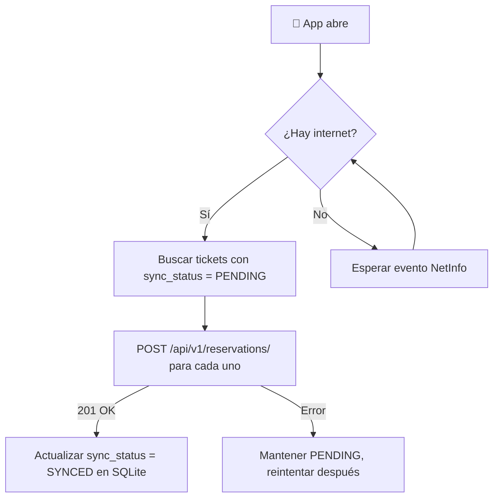

# Komodo — Fase 3: App Móvil React Native (MVP)

## Objetivo

Construir la aplicación móvil multiplataforma (Android + iOS) usando **React Native con Expo**. El MVP cubre el flujo completo del pasajero: buscar viaje → seleccionar asiento → comprar boleto → ver QR offline.

> [!IMPORTANT]
> El **Panel de Administración Web** (React) queda fuera de esta fase. No es necesario para lanzar el MVP porque las rutas, terminales y viajes ya se cargan via seeds en la DB. Se abordará en una fase posterior.

---

## Principios de Diseño (Basado en DESIGN.md)

| Principio | Aplicación |
|-----------|-----------|
| **Minimalismo** | Máximo espacio en blanco, sin decoraciones innecesarias. Cada elemento tiene un propósito funcional. |
| **Iconos Semi-Redondos** | `borderRadius: 16` en cards, `borderRadius: 12` en botones, `borderRadius: 9999` en chips/tags (pill). |
| **Paleta Funcional** | Indigo `#4F46E5` (marca), Teal `#0D9488` (acciones primarias), Amber `#FFBF00` (acentos), Neutrales Slate. |
| **Tipografía Inter** | Bold para títulos y precios, Semibold para botones, Regular para cuerpo. |
| **Offline-First** | SQLite local para boletos y QR. Cola de sincronización automática vía NetInfo. |

---

## Stack Tecnológico

| Capa | Tecnología | Justificación |
|------|-----------|---------------|
| Framework | Expo SDK 53+ (Managed Workflow) | Build nativo sin Xcode/Android Studio. Un solo codebase para Android + iOS. |
| Navegación | `expo-router` (file-based) | Navegación declarativa tipo Next.js, ideal para MVP. |
| HTTP Client | `fetch` nativo | Sin dependencias extra. Los payloads ya vienen comprimidos via gzip del Gateway. |
| Almacenamiento Local | `expo-sqlite` | Almacena boletos confirmados y QR data para acceso offline. |
| Conectividad | `@react-native-community/netinfo` | Detecta cambios de red para disparar la cola de sincronización. |
| QR Code | `react-native-qrcode-svg` | Renderiza el `qr_code_data` que ya genera el backend. |
| Iconos | `@expo/vector-icons` (Ionicons) | Iconos limpios y semi-redondos que encajan con el diseño minimalista. |

---

## Estructura de Directorios

```
mobile/
├── app.json                          # Configuración Expo (nombre, splash, iconos)
├── package.json
├── babel.config.js
├── app/                              # expo-router (file-based routing)
│   ├── _layout.tsx                   # Layout raíz + Tab Navigator
│   ├── (tabs)/                       # Tab screens
│   │   ├── _layout.tsx               # Tab bar configuration
│   │   ├── index.tsx                 # 🏠 Home (Buscador)
│   │   ├── trips.tsx                 # 🎫 My Trips (Boletos)
│   │   └── profile.tsx               # 👤 Profile
│   ├── search-results.tsx            # Resultados de búsqueda
│   ├── select-seat.tsx               # Selección de asiento (mapa del bus)
│   ├── checkout.tsx                  # Confirmación y pago
│   └── ticket/[id].tsx               # Detalle de boleto + QR
├── components/
│   ├── TripCard.tsx                  # Card de resultado de viaje
│   ├── SeatGrid.tsx                  # Mapa visual de asientos del bus
│   ├── QRTicket.tsx                  # Componente de QR para mostrar offline
│   ├── SearchForm.tsx                # Formulario Origen → Destino + Fecha
│   └── SyncBadge.tsx                 # Badge visual de estado de sincronización
├── lib/
│   ├── api.ts                        # Cliente HTTP (fetch wrapper hacia el Gateway)
│   ├── storage.ts                    # Capa de SQLite (guardar/leer boletos)
│   ├── sync.ts                       # Cola de sincronización offline
│   └── theme.ts                      # Tokens de diseño (colores, tipografía, radios)
└── assets/                           # Splash, iconos, fuentes Inter
```

---

## Pantallas del MVP

### 1. Home (Buscador) — `(tabs)/index.tsx`

Pantalla principal con el formulario de búsqueda.

**Elementos:**
- Header: Logo Komodo + avatar del usuario
- Título: "Where to next?"
- Formulario con 2 inputs grandes (FROM / TO) con iconos (círculo hueco / pin sólido)
- Selectores de Fecha y Pasajeros (chips semi-redondos)
- Botón "Search Routes →" (Teal `#0D9488`, `borderRadius: 16`)
- Sección "Recent Searches" debajo

**API Consumida:** Ninguna (solo UI local, los datos se envían al buscar).

---

### 2. Resultados de Búsqueda — `search-results.tsx`

Lista de viajes disponibles para la ruta seleccionada.

**Elementos:**
- Header con la ruta (ej: "Caracas → Maracaibo")
- Chips de filtro (pill-shaped: Hora, Precio, Asientos)
- Lista de `TripCard` con:
  - Hora de salida → duración → hora de llegada (línea de timeline)
  - Terminal origen → Terminal destino
  - Asientos disponibles (icono teal)
  - Precio en USD
  - Botón "Select" (borde Indigo, ghost style)

**API Consumida:**
```
GET /api/v1/search?origin={uuid}&destination={uuid}&date=YYYY-MM-DD
```
**Mapeo de Keys Cortas → UI:**
| Key del Gateway | Campo en UI |
|----------------|-------------|
| `tid` | ID interno (no visible) |
| `org` | Terminal de origen |
| `dst` | Terminal de destino |
| `dep` | Hora de salida |
| `arr` | Hora de llegada |
| `avl` | "X seats left" |
| `prc` | Precio mostrado |
| `rc` | Código de ruta (chip) |

---

### 3. Selección de Asiento — `select-seat.tsx`

Mapa visual del autobús con asientos seleccionables.

**Elementos:**
- Header con la ruta resumida (ej: "NY → BOS")
- Grid de asientos 4 columnas (2 + pasillo + 2)
- Estados visuales:
  - ⬜ Disponible: fondo `#F1F5F9`, borde `#E2E8F0`, `borderRadius: 12`
  - 🟦 Seleccionado: fondo Indigo `#4F46E5`, texto blanco
  - ❌ Vendido: icono "×", fondo `#F8FAFC`, texto `#CBD5E1`
- Footer sticky: "Total Price: $XX" + Botón "Continue" (Teal)

**APIs Consumidas:**
```
GET  /api/v1/trips/{trip_id}      → Mapa de asientos (Core/FastAPI)
POST /api/v1/hold-seat            → Bloqueo temporal (Gateway/Redis)
```

---

### 4. Checkout — `checkout.tsx`

Pantalla de confirmación y pago.

**Elementos:**
- Resumen del viaje (card con borde dashed tipo "boleto desprendible")
- Asiento seleccionado
- Total a pagar
- Campo de método de pago (mock para MVP: botón "Confirm Purchase")
- Spinner de carga durante la transacción

**API Consumida:**
```
POST /api/v1/reservations/        → Confirmar compra (Core/FastAPI)
```
**Payload enviado:**
```json
{
  "idempotency_key": "uuid-v4-generado-en-el-móvil",
  "user_id": "...",
  "seat_id": "...",
  "trip_id": "...",
  "amount_paid": 35.00,
  "currency": "USD"
}
```

---

### 5. My Trips — `(tabs)/trips.tsx`

Lista de boletos comprados (tabs: Upcoming / Past).

**Elementos:**
- Tabs "Upcoming" / "Past" (borde inferior Indigo para activo)
- Lista de TicketCards con:
  - Destino + tipo de servicio (chip: "Express", "Standard")
  - Fecha + hora
  - Gate + Seat
  - Mini ícono QR (tap para ir al detalle)
- Badge `SyncBadge` si el boleto está pendiente de sincronización
- Botón flotante "+ Book New Trip" (Amber Gold `#FFBF00`)

**Datos:** Lee directamente de SQLite local (funciona offline).

---

### 6. Detalle de Boleto + QR — `ticket/[id].tsx`

Pantalla de boleto individual con QR a pantalla completa.

**Elementos:**
- Card tipo boleto (borde dashed, `borderRadius: 24`)
- Información: Ruta, fecha, hora, asiento, monto pagado
- QR Code grande (renderizado desde `qr_code_data` almacenado localmente)
- Texto: "Show this to the driver" (label-sm, color Slate)
- Botón "Download PDF" (futuro, no MVP)

**Datos:** Lee de SQLite. Funciona 100% offline.

---

## Capa de Datos y Offline-First

### `lib/api.ts` — Cliente HTTP

```typescript
const GATEWAY_URL = "http://<gateway-ip>:8080";
const CORE_URL = "http://<core-ip>:8000";

// Búsqueda → Gateway (con caché Redis)
export const searchTrips = (origin, dest, date) =>
  fetch(`${GATEWAY_URL}/api/v1/search?origin=${origin}&destination=${dest}&date=${date}`)

// Hold seat → Gateway (bloqueo Redis)
export const holdSeat = (tripId, seatId, userId) =>
  fetch(`${GATEWAY_URL}/api/v1/hold-seat`, { method: "POST", body: ... })

// Compra → Core (transacción ACID)
export const confirmReservation = (payload) =>
  fetch(`${CORE_URL}/api/v1/reservations/`, { method: "POST", body: ... })
```

### `lib/storage.ts` — SQLite Local

Tabla local `tickets`:
```sql
CREATE TABLE IF NOT EXISTS tickets (
  id TEXT PRIMARY KEY,
  trip_id TEXT,
  seat_number INTEGER,
  origin TEXT,
  destination TEXT,
  departure_at TEXT,
  qr_code_data TEXT,       -- El string que renderiza el QR
  status TEXT,              -- CONFIRMED | PENDING
  sync_status TEXT,         -- SYNCED | PENDING
  raw_json TEXT,            -- Respuesta completa del servidor
  created_at TEXT DEFAULT CURRENT_TIMESTAMP
);
```

### `lib/sync.ts` — Cola de Sincronización



---

## Tokens de Diseño (`lib/theme.ts`)

```typescript
export const theme = {
  colors: {
    primary: '#4F46E5',          // Indigo
    primaryContainer: '#E2DFFF',
    action: '#0D9488',           // Teal
    accent: '#FFBF00',           // Amber Gold
    error: '#BA1A1A',
    background: '#FFFFFF',
    surface: '#F7F9FB',
    surfaceContainer: '#F1F5F9',
    textPrimary: '#1E293B',      // Slate-800
    textSecondary: '#64748B',    // Slate-500
    textMuted: '#94A3B8',        // Slate-400
    border: '#E2E8F0',           // Slate-200
  },
  radius: {
    sm: 4,
    md: 8,
    lg: 12,
    xl: 16,     // Botones e inputs
    xxl: 24,    // Cards principales
    full: 9999, // Chips pill
  },
  spacing: {
    xs: 4,
    sm: 8,
    md: 16,
    lg: 24,
    xl: 32,
  },
  typography: {
    fontFamily: 'Inter',
  },
};
```

---

## Proposed Changes (Archivos a Crear)

### Configuración del Proyecto

#### [NEW] `mobile/package.json`
#### [NEW] `mobile/app.json`
#### [NEW] `mobile/babel.config.js`
#### [NEW] `mobile/tsconfig.json`

---

### Navegación y Layouts

#### [NEW] `mobile/app/_layout.tsx`
- Layout raíz con providers y carga de fuentes Inter.

#### [NEW] `mobile/app/(tabs)/_layout.tsx`
- Tab Navigator con 3 tabs: Home, My Trips, Profile.
- Tab bar con iconos Ionicons (24px), activo en Indigo `#4F46E5`.

---

### Pantallas

#### [NEW] `mobile/app/(tabs)/index.tsx` — Home
#### [NEW] `mobile/app/(tabs)/trips.tsx` — My Trips
#### [NEW] `mobile/app/(tabs)/profile.tsx` — Profile (placeholder MVP)
#### [NEW] `mobile/app/search-results.tsx`
#### [NEW] `mobile/app/select-seat.tsx`
#### [NEW] `mobile/app/checkout.tsx`
#### [NEW] `mobile/app/ticket/[id].tsx`

---

### Componentes Reutilizables

#### [NEW] `mobile/components/SearchForm.tsx`
#### [NEW] `mobile/components/TripCard.tsx`
#### [NEW] `mobile/components/SeatGrid.tsx`
#### [NEW] `mobile/components/QRTicket.tsx`
#### [NEW] `mobile/components/SyncBadge.tsx`

---

### Capa de Datos

#### [NEW] `mobile/lib/theme.ts` — Design tokens
#### [NEW] `mobile/lib/api.ts` — HTTP client
#### [NEW] `mobile/lib/storage.ts` — SQLite CRUD
#### [NEW] `mobile/lib/sync.ts` — Cola de sincronización offline

---

## Verification Plan

### Automated Tests
- No aplican para el MVP móvil. La verificación será manual.

### Manual Verification
1. `npx expo start` → La app abre sin errores en el simulador iOS y Android.
2. Flujo completo: Home → Search → Select Seat → Checkout → Ver QR.
3. Activar modo avión → Abrir "My Trips" → Verificar que el QR se muestra desde SQLite.
4. Desactivar modo avión → Verificar que la cola de sync ejecuta automáticamente.
