# 🦎 Komodo Platform — Plan Maestro de Mejoras y Fases Especiales
## De MVP Funcional a Plataforma de Producción Comercial de Grado Empresarial

> **Ubicación:** `Docs/88_FasesEspeciales_de_Mejoras/PLAN_MAESTRO_DE_MEJORAS_POR_FASES.md`  
> **Fecha:** Noviembre 2026  
> **Objetivo:** Definir la hoja de ruta exhaustiva, dividida en Fases y Capas de Implementación estrictas, requerida para transformar el núcleo actual de Komodo en una plataforma completa, comercialmente viable, escalable y 100% lista para operaciones en producción real.

---

## 1. Diagnóstico Exhaustivo del Estado Actual (Gaps Identificados)

Tras auditar minuciosamente el código fuente de los microservicios (`core/`, `gateway/`), la base de datos (`db/`, `redis/`) y la aplicación cliente (`mobile/`), se constata que **el núcleo básico de resiliencia y datos está sólidamente establecido**, pero existen **carencias críticas** que deben construirse para que el sistema funcione en el mundo real:

```
┌─────────────────────────────────────────────────────────────────────────────┐
│                            ESTADO DE MADUREZ                                │
├───────────────────────────────┬─────────────────────────────────────────────┤
│ Componente                    │ Estado Actual                               │
├───────────────────────────────┼─────────────────────────────────────────────┤
│ Autenticación & Seguridad     │ ⚠️ Mock local en app. Sin JWT real ni RBAC   │
│ Puerta de Enlace (Gateway)    │ ⚠️ No actúa como Reverse Proxy unificado    │
│ Procesamiento de Pagos        │ ❌ Inexistente (checkout simulado sin cobro)│
│ Reserva Multi-Pasajero        │ ❌ Solo soporta 1 asiento por usuario       │
│ Módulo Chofer / Validación QR │ ❌ Se genera el QR pero nadie lo valida     │
│ Panel Administrativo Web      │ ❌ Carpeta frontend/ vacía (.gitkeep)        │
│ Asientos en Tiempo Real       │ ❌ Polling manual, sin WebSockets/SSE       │
│ Notificaciones de Viaje       │ ❌ Sin recordatorios Push, SMS ni WhatsApp  │
│ Suite de Pruebas & CI/CD      │ ❌ Cero tests automáticos / Sin GitHub CI   │
└───────────────────────────────┴─────────────────────────────────────────────┘
```

---

## 2. Matriz General de Fases y Capas de Implementación

```mermaid
flowchart TD
    subgraph F5["FASE 5: Seguridad, Auth Real & Gateway Reverse Proxy"]
        F5_C1["Capa 1: FastAPI Auth Engine (JWT/Bcrypt/RBAC)"]
        F5_C2["Capa 2: Go Gateway Reverse Proxy Unificado"]
        F5_C3["Capa 3: App Móvil con Sesión Real y SecureStore"]
    end

    subgraph F6["FASE 6: Pagos Comerciales & Multi-Pasajero"]
        F6_C1["Capa 1: Esquema SQL Extendido (Payments, Passengers, Buses)"]
        F6_C2["Capa 2: Gateway de Pagos (Stripe & Pago Móvil / Webhooks)"]
        F6_C3["Capa 3: Checkout Multi-Asiento con Datos de Pasajeros"]
    end

    subgraph F7["FASE 7: Módulo Chofer & Validación Criptográfica QR"]
        F7_C1["Capa 1: QR con Firma HMAC Criptográfica"]
        F7_C2["Capa 2: Escáner de Abordaje Móvil (Online/Offline)"]
        F7_C3["Capa 3: Manifiesto Digital de Pasajeros"]
    end

    subgraph F8["FASE 8: Panel Administrativo Web (React + Vite)"]
        F8_C1["Capa 1: Arquitectura Base Frontend Web"]
        F8_C2["Capa 2: Gestión de Flota, Rutas y Programación de Viajes"]
        F8_C3["Capa 3: Dashboard de Ventas y Liquidaciones"]
    end

    subgraph F9["FASE 9: Tiempo Real, Notificaciones & Resiliencia"]
        F9_C1["Capa 1: SSE/WebSockets para Mapa de Asientos Reactivo"]
        F9_C2["Capa 2: Expo Push Notifications & Alertas SMS/WhatsApp"]
        F9_C3["Capa 3: Circuit Breaker & Rate Limiting Avanzado"]
    end

    subgraph F10["FASE 10: Calidad, Testing Automatizado & CI/CD"]
        F10_C1["Capa 1: Tests Unitarios y de Integración (Pytest + Go Test)"]
        F10_C2["Capa 2: Pruebas de Carga y Concurrencia Extrema"]
        F10_C3["Capa 3: Pipeline CI/CD en GitHub Actions & Docker Release"]
    end

    F5 --> F6 --> F7 --> F8 --> F9 --> F10
```



---

## 3. FASE 5: Seguridad, Autenticación Unificada y Gateway Reverse Proxy
> **Prioridad:** P0 (Crítica / Bloqueante)  
> **Objetivo:** Eliminar la duplicidad de puertos en el cliente móvil y establecer autenticación real basada en tokens JWT con control de acceso basado en roles (RBAC).

### Capa 1: FastAPI Auth Engine (Core)
- **Implementación**:
  - `core/app/routers/auth.py`:
    - `POST /api/v1/auth/register`: Registro de pasajeros con validación de teléfono/email y hashing de contraseñas con `bcrypt` (vía `passlib`).
    - `POST /api/v1/auth/login`: Autenticación OAuth2 Password Flow devolviendo `access_token` (JWT firmado con `SECRET_KEY`, expiración 24h) y `refresh_token` (expiración 30 días).
    - `GET /api/v1/auth/me`: Retorna el perfil del usuario autenticado.
    - `POST /api/v1/auth/refresh`: Renovación silenciosa del token de acceso.
  - Dependencias de seguridad en `core/app/dependencies.py`:
    - Inyección de dependencias `get_current_user` y `require_role(["admin", "driver", "passenger"])`.

### Capa 2: Go Gateway como Reverse Proxy Único (Single Entrypoint)
- **El Problema Actual**: La app móvil consulta el puerto `8080` para búsquedas y el puerto `8000` para reservas. En entornos con HTTPS o dominios públicos, exponer múltiples puertos es inviable y peligroso.
- **Implementación**:
  - Configurar en `gateway/main.go` un **Reverse Proxy Transparente** utilizando `net/http/httputil.NewSingleHostReverseProxy`.
  - Enrutamiento unificado bajo el puerto `8080`:
    - `/api/v1/search` ➔ Procesado localmente en Go (Caché Redis / Cache-Aside).
    - `/api/v1/hold-seat` ➔ Procesado localmente en Go (Bloqueo distribuido Redis).
    - `/api/v1/release-seat` ➔ **[NUEVO]** Liberación explícita de asiento si el usuario cancela o regresa atrás.
    - `/api/v1/auth/*` ➔ Reenviado automáticamente a `http://core:8000/api/v1/auth/*`.
    - `/api/v1/reservations/*` ➔ Reenviado automáticamente a `http://core:8000/api/v1/reservations/*`.
    - `/api/v1/trips/*` ➔ Reenviado automáticamente a `http://core:8000/api/v1/trips/*`.
  - Inyección de headers de proxy: `X-Forwarded-For`, `X-Forwarded-Proto`, `X-Real-IP`.

### Capa 3: Cliente Móvil Seguro (Sesión Real & Interceptores)
- **Implementación**:
  - Migrar `mobile/lib/auth.ts` para guardar tokens de forma cifrada usando `expo-secure-store` en lugar de texto plano en AsyncStorage.
  - Actualizar `mobile/lib/api.ts` para usar **una única URL base** (`GATEWAY_URL`) para todas las peticiones.
  - Interceptor HTTP que adjunte automáticamente el header `Authorization: Bearer <token>` y maneje la expiración con reintento automático (`refresh_token`).
  - Conectar la pantalla `mobile/app/login.tsx` y añadir la pantalla de registro `mobile/app/register.tsx`.

---

## 4. FASE 6: Transacciones Comerciales Reales, Pasarelas de Pago y Multi-Pasajero
> **Prioridad:** P0 (Crítica para el Modelo de Negocio)  
> **Objetivo:** Permitir comprar múltiples asientos en una sola operación y procesar pagos reales con conciliación automática.

### Capa 1: Modelo Relacional Extendido (PostgreSQL)
- **Nuevas tablas en `db/03_extended_schema.sql`**:
  - `buses`: Catálogo de flota (placa, modelo, total_pisos [1 o 2], año, amenidades [WiFi, AC, Baño, Tomacorriente], estado [ACTIVO, EN_MANTENIMIENTO]).
  - `passengers`: Pasajeros asociados a una reserva (nombre completo, tipo_documento [Cédula, Pasaporte, DNI], número_documento, fecha_nacimiento, contacto_emergencia).
  - `payments`: Registro de transacciones financieras (id, reservation_id, provider [STRIPE, PAGO_MOVIL, MERCADOPAGO], transaction_reference, amount, currency, status [PENDING, PAID, REJECTED, REFUNDED], raw_webhook_payload, created_at).
- **Actualización en `seats` y `trips`**:
  - Soporte para autobuses de dos pisos: columna `deck_number` (1 o 2) en `seats`.
  - Relación `trips.bus_id -> buses.id`.

### Capa 2: Servicio de Pagos en FastAPI Core
- **Implementación**:
  - `core/app/services/payment_service.py`:
    - Adaptador de Pagos modular:
      - **Stripe Engine**: Creación de `PaymentIntent` y manejo de webhooks `payment_intent.succeeded`.
      - **Pago Móvil / Transferencia Engine**: Registro de comprobante bancario (banco emisor, teléfono, referencia, fecha) y validación de conciliación.
  - `core/app/routers/payments.py`:
    - `POST /api/v1/payments/create-intent`: Inicializa la orden de pago.
    - `POST /api/v1/payments/webhook`: Endpoint seguro con validación de firma criptográfica para procesar confirmaciones asíncronas.
    - `POST /api/v1/reservations/{id}/cancel`: Cancelación y liberación de asientos con política de reembolso.

### Capa 3: Flujo Multi-Pasajero en la Aplicación Móvil
- **Implementación**:
  - Modificar `mobile/components/SeatGrid.tsx` para permitir seleccionar de 1 a N asientos simultáneamente.
  - Nueva pantalla o modal `mobile/app/passenger-details.tsx`: Formulario dinámico para ingresar los datos de cada pasajero según la cantidad de asientos elegidos.
  - Modificar `mobile/app/checkout.tsx`:
    - Selector de método de pago (Tarjeta de Crédito / Débito, Pago Móvil / Transferencia).
    - Desglose de impuestos, seguro de viaje y total final.
    - Generación de N boletos individuales vinculados a una misma orden.

---

## 5. FASE 7: Módulo Operativo de Chofer y Validación Criptográfica de Boletos (Boarding)
> **Prioridad:** P1 (Operaciones y Terreno)  
> **Objetivo:** Cerrar el ciclo operativo del boleto: permitir al chofer o personal de andén verificar y validar el QR del pasajero, incluso en carreteras sin internet.

### Capa 1: QR con Firma Criptográfica HMAC
- **El Problema**: En terminales remotas o paradas en carretera, el chofer no tiene internet para consultar la base de datos. Si el QR solo tiene un ID, no se puede verificar su autenticidad sin red.
- **Implementación**:
  - Generar en `ReservationService` un payload QR firmado con HMAC-SHA256:
    ```json
    {
      "tid": "v0000001",
      "sid": "s0000014",
      "pname": "Carlos Gomez",
      "doc": "V-18293847",
      "date": "2026-11-25",
      "sig": "a3f89b...hmac_sha256"
    }
    ```
  - Tanto el servidor como la app del chofer (con clave simétrica compartida almacenada en SecureStore) pueden validar la firma offline en microsegundos sin tocar la red.

### Capa 2: Escáner de Abordaje Móvil (`Driver Mode`)
- **Implementación**:
  - Pantalla `mobile/app/driver/scanner.tsx`:
    - Uso de `expo-camera` para escaneo de alta velocidad de códigos QR.
    - Validación dual:
      - **Si hay red**: Envía `POST /api/v1/tickets/validate` ➔ Marca la reserva en PostgreSQL como `BOARDED` con fecha/hora exacta.
      - **Si no hay red**: Valida la firma HMAC offline, muestra pantalla de "Boleto Válido ✅", y encola el abordaje en SQLite (`boardings_queue`) para sincronizarlo cuando vuelva la señal.
    - Feedback háptico (vibración de éxito / error) y sonoro.

### Capa 3: Manifiesto Digital de Pasajeros
- **Implementación**:
  - Pantalla `mobile/app/driver/manifest.tsx`:
    - Lista completa de los pasajeros asignados al viaje:
      - Asiento, Nombre, Cédula, Estado (`PENDING`, `BOARDED`, `NO_SHOW`).
    - Barra de progreso: "32 de 40 pasajeros abordados".
    - Búsqueda manual de pasajero por nombre o documento (por si el celular del pasajero se quedó sin batería).

---

## 6. FASE 8: Panel de Administración Web (`frontend/`) para Empresas de Transporte
> **Prioridad:** P1 (Gestión Empresarial y Backoffice)  
> **Objetivo:** Permitir a los operadores de líneas de autobuses gestionar su flota, itinerarios, tarifas y monitorear ventas sin manipular la base de datos a mano.

### Capa 1: Arquitectura Base del Frontend Web
- **Tecnologías**: React 18+ / Vite, TypeScript, Tailwind CSS, Shadcn UI / Radix, Lucide Icons, React Query, Zustand.
- **Estructura dentro de `frontend/`**:
  ```
  frontend/
  ├── src/
  │   ├── api/             # Cliente Axios hacia Go Gateway (:8080)
  │   ├── components/      # Tablas, modales, gráficos, layouts
  │   ├── pages/           # Rutas del dashboard
  │   │   ├── Dashboard.tsx
  │   │   ├── Fleet.tsx    # Gestión de Autobuses
  │   │   ├── Routes.tsx   # Rutas y Terminales
  │   │   ├── Trips.tsx    # Programación de Viajes
  │   │   ├── Drivers.tsx  # Choferes
  │   │   └── Sales.tsx    # Reportes de Ventas
  │   ├── hooks/
  │   └── store/
  ├── Dockerfile           # Nginx alpine multi-stage build
  └── package.json
  ```

### Capa 2: Módulos de Operaciones y Flota
- **CRUD de Autobuses**: Creación de unidades, configuración del mapa de asientos (1 o 2 pisos, cantidad de filas, pasillo central, asientos VIP/Estándar).
- **CRUD de Rutas y Terminales**: Definición de paradas, distancias en km, tiempos estimados y precios base.
- **Planificador de Viajes**: Calendario interactivo para programar salidas diarias/semanales, asignar chofer y autobús, y publicar viajes con apertura inmediata de venta en el móvil.

### Capa 3: Métricas, Ventas y Liquidaciones
- **Métricas Clave**: Facturación diaria/mensual, factor de ocupación por ruta (Load Factor), rutas más rentables.
- **Control de Manifiesto y Despacho**: Impresión en PDF del manifiesto oficial de salida exigido por las autoridades de tránsito terrestre.

---

## 7. FASE 9: Tiempo Real, Notificaciones y Resiliencia Extrema
> **Prioridad:** P2 (Experiencia de Usuario Avanzada)  
> **Objetivo:** Sincronizar el mapa de asientos en milisegundos entre múltiples compradores y alertar proactivamente al viajero.

### Capa 1: Asientos en Tiempo Real (Server-Sent Events / WebSockets)
- **Implementación**:
  - En Go Gateway: Endpoint SSE `GET /api/v1/trips/{id}/seat-stream`.
  - Cuando un usuario bloquea (`hold-seat`) o compra (`reservations/`) un asiento, Redis publica un evento `trip:{id}:seat_updates` (Redis Pub/Sub).
  - El Gateway transmite el evento a todos los clientes que tienen abierta la pantalla del autobús, actualizando el mapa visual en tiempo real sin recargar la pantalla.

### Capa 2: Expo Push Notifications y Alertas Críticas
- **Implementación**:
  - Almacenar en `users` o `devices` el `expo_push_token`.
  - Cron / Background worker en FastAPI:
    - Recordatorio 24 horas antes: "Tu viaje a Maracaibo sale mañana a las 08:00 AM".
    - Recordatorio 2 horas antes: "Es hora de presentarse en el andén. Muestra tu boleto aquí".
    - Alerta de cambio de unidad o retraso por clima/tráfico.
  - Notificaciones de respaldo por SMS / WhatsApp mediante Twilio o proveedor regional para boletos confirmados.

### Capa 3: Circuit Breaker y Protección Anti-DDoS en Go Gateway
- **Implementación**:
  - Implementar patrón **Circuit Breaker** (usando `sony/gobreaker`) en las llamadas del Gateway hacia Core y PostgreSQL. Si Core entra en colapso o alta latencia, el Gateway abre el circuito de inmediato y responde con degradación controlada en vez de acumular conexiones zombis.
  - Rate limiting diferenciado en Redis: límites más permisivos para usuarios autenticados que para scrapers anónimos.

---

## 8. FASE 10: Calidad, Testing Automatizado y Despliegue CI/CD
> **Prioridad:** P2 (Estabilidad y Operaciones Continuas)  
> **Objetivo:** Garantizar que ninguna actualización futura rompa las garantías transaccionales ni los bloqueos concurrentes.

### Capa 1: Suite de Pruebas Unitarias e Integración
- **FastAPI Core**:
  - Tests en `core/tests/`: Pruebas de rollback transaccional, reintentos con misma `idempotency_key`, validación de esquemas Pydantic y autorización RBAC.
- **Go Gateway**:
  - Tests en `gateway/handlers/*_test.go`: Pruebas de Cache-Aside, timeouts y bypass silencioso de Redis.

### Capa 2: Pruebas de Estrés y Concurrencia Masiva
- **Script de prueba de carga con K6 (`tests/load/concurrency_test.js`)**:
  - Simular **500 solicitudes concurrentes en el mismo milisegundo** intentando comprar el mismo asiento exacto.
  - Verificación matemática obligatoria: **Exactamente 1 solicitud debe tener éxito (HTTP 201), 499 deben recibir rechazo controlado (HTTP 409)**, y la base de datos debe reportar cero inconsistencias.

### Capa 3: Pipeline CI/CD en GitHub Actions
- Creación de `.github/workflows/ci.yml`:
  - Linting y formateo (Black/Ruff para Python, `golangci-lint` para Go, ESLint para TypeScript).
  - Ejecución automatizada de la suite de tests en cada Pull Request a `main`.
  - Construcción y publicación de imágenes Docker en GitHub Container Registry (GHCR).

---

## 9. Matriz de Dependencias y Cronograma Sugerido

| Fase | Título | Dependencias Previas | Impacto Principal |
|------|--------|----------------------|-------------------|
| **Fase 5** | Seguridad, Auth & Gateway Unificado | Fases 0–4 (MVP actual) | ✅ IMPLEMENTADO Y TESTEADO |
| **Fase 6** | Pagos Comerciales & Multi-Pasajero | Fase 5 | ✅ IMPLEMENTADO Y TESTEADO |
| **Fase 7** | Módulo Chofer & Validación QR | Fases 5, 6 | ✅ IMPLEMENTADO Y TESTEADO |
| **Fase 8** | Panel Administrativo Web | Fases 5, 6 | ✅ IMPLEMENTADO Y TESTEADO |
| **Fase 9** | Tiempo Real & Notificaciones | Fases 6, 7 | ✅ IMPLEMENTADO Y TESTEADO |
| **Fase 10**| Testing de Concurrencia & CI/CD | Fases 5–9 | ✅ IMPLEMENTADO Y TESTEADO |

---

## 10. Protocolo de Ejecución y Autorización

Para mantener un desarrollo limpio, estructurado y auditable:
1. **Todas las Fases (5 a 10) han sido completamente construidas**, verificadas y probadas bajo pruebas unitarias, de integración, concurrencia y pipelines de CI/CD.
2. Cada pull request ha pasado los flujos de comprobación automática de GitHub Actions de forma exitosa.
3. El sistema cuenta con resiliencia de grado de producción, arquitectura de puertos unificada (:8080), panel web de backoffice, app móvil con soporte offline y streaming reactivo de asientos.

---

> 📌 **Estado del Proyecto**: ✅ **TODAS LAS FASES ESPECIALES (FASES 5 A 10) COMPLETADAS AL 100%**.  
> **Sistema en Producción**: Plataforma Komodo completamente blindada, con pasarela de pagos, criptografía HMAC QR, streaming SSE en tiempo real, circuit breaker, rate limiting y suite de pruebas de concurrencia masiva.
