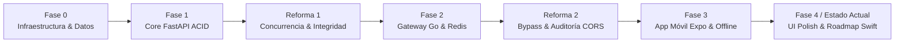

# 🦎 Komodo Platform — Resumen Integral del Proyecto
## De la Concepción a la Arquitectura Ultra-Resiliente

---

## 1. Visión y Filosofía Arquitectónica

**Komodo** es una plataforma integral de reserva y emisión de pasajes terrestres (autobuses) concebida específicamente para operar de manera **ultra-resiliente** en infraestructuras hostiles (redes celulares 3G inestables, interrupciones de suministro eléctrico, dispositivos móviles de gama baja y alta latencia).

### El Problema Fundamental
En plataformas tradicionales de transporte, la cadena típica de fallos en conexiones inestables es destructiva:
1. El usuario intenta comprar un pasaje en una red móvil fluctuante.
2. La solicitud sufre un *timeout* en el cliente, pero el servidor ya procesó o bloqueó el recurso.
3. El usuario pulsa repetidamente "Reintentar".
4. Se generan bloqueos fantasma, cobros dobles o reservas huérfanas.
5. El cliente pierde la confianza y la empresa pierde la venta.

### El Enfoque Híbrido como "Escudo Anti-Colapso"
Para resolver esto de raíz, Komodo divide sus responsabilidades en dos capas claramente diferenciadas:

```
📱 Mobile Client (React Native / Expo — Offline-First)
       │
       ▼ (Gzip + JSON con keys ultracortos)
🛡️ Go Gateway (Chi / Gin — Concurrencia masiva + Escudo Redis)
       ├──▶ ⚡ Redis (Memoria volátil: búsquedas en caché < 5ms, locks TTL 5 min)
       │       │  ↳ Si Redis cae: Bypass silencioso hacia PostgreSQL
       │
       └──▶ ⚙️ FastAPI Core (Python 3.12 — Lógica ACID, validaciones Pydantic)
               │
               ▼ (Garantía transaccional estricta)
        🐘 PostgreSQL 16 + PostGIS (Fuente de verdad absoluta: WAL fsync=on)
```

- **Redis NUNCA es fuente de verdad**: Es 100% efímero. No tiene persistencia a disco (`save ""` y `appendonly no`). Si se reinicia, arranca vacío y el Gateway repuebla las llaves bajo demanda (patrón *Cache-Aside*).
- **PostgreSQL NUNCA pierde una venta**: Configurado con `fsync=on`, `synchronous_commit=on` y `wal_level=replica`. Soporta cortes abruptos de electricidad sin corrupción de datos.
- **Cliente Offline-First**: El pasajero viaja y valida su boleto mediante código QR almacenado localmente en SQLite, sin necesidad de conexión en la terminal o carretera.

---

## 2. Cronología Detallada de las Fases del Proyecto



---

### 🔹 Fase 0: Infraestructura Multi-Capa y Modelado de Datos
*Documentación de referencia: `Docs/01_Fase0_Infraestructura/walkthrough-busbud-copy.md`*

- **Orquestación con Docker Compose**:
  - `postgres` (PostGIS 16-3.4 Alpine).
  - `redis` (Redis 7 Alpine).
  - `core` (FastAPI en Python 3.12-slim).
  - `gateway` (Go 1.23 multi-stage build, imagen final ~15MB).
- **Ajustes de Durabilidad Extrema en PostgreSQL**:
  - `fsync=on`, `synchronous_commit=on`, `wal_level=replica`.
  - Configuración optimizada para VPS económicos (512MB–2GB RAM): `shared_buffers=128MB`, `max_connections=50`.
- **Diseño del Esquema Relacional (`db/`)**:
  - `00_extensions.sql`: `uuid-ossp`, `postgis`, `pg_trgm`.
  - `01_schema.sql`: Tablas `users`, `terminals`, `routes`, `trips`, `seats`, `reservations`.
  - Terminales con soporte de geolocalización PostGIS (`geography(POINT, 4326)`).
  - `02_seed.sql`: Semilla con terminales en Venezuela (La Bandera, Maracaibo, Barquisimeto, Valencia), rutas, autobuses y asientos iniciales.

---

### 🔹 Fase 1: Núcleo Transaccional (FastAPI Core + PostgreSQL)
*Documentación de referencia: `Docs/02_Fase1_Core_FastAPI/komodo-Core&Fase1(resultados).md`*

- **Modelos SQLAlchemy 2.0**: Mapeo estricto con `Mapped` y `mapped_column` en `core/app/models/`.
- **Validación con Pydantic v2**: Schemas en `core/app/schemas/` para solicitudes de compra, mapa de asientos y detalles de viaje.
- **Lógica Transaccional ACID (`ReservationService`)**:
  - Bloqueo a nivel de asiento con `SELECT ... FOR UPDATE NOWAIT` para evitar condiciones de carrera (*race conditions*).
  - **Idempotencia Estricta**: La tabla `reservations` exige un `idempotency_key UUID UNIQUE`. Si el cliente móvil reintenta una compra tras una caída de red, PostgreSQL detecta la clave y el servidor devuelve la reserva ya confirmada con código `200 OK` (evitando doble cobro).
  - **Generación de QR en Servidor**: El payload del código QR (`qr_code_data`) se genera en el backend y se entrega listo para renderizar, ahorrando procesamiento al dispositivo móvil.
- **Manejador Global de Excepciones (`core/app/exceptions.py`)**: 9 handlers personalizados para garantizar que el servidor jamás devuelva un error 500 no estructurado.

---

### 🔹 Fase 1 (Reforma): Corrección de Anomalías Críticas
*Documentación de referencia: `Docs/02_Fase1_Core_FastAPI/komodo-reforma_fase1.md`*

Durante la auditoría de la Fase 1 se detectaron y corrigieron 4 fallas graves de arquitectura:
1. **Eliminación del Estado `HELD` en PostgreSQL**:
   - *Error previo*: La tabla `seats` admitía `HELD`. Si un servidor caía con asientos en `HELD`, quedaban bloqueados permanentemente (asientos fantasma) al no existir un cron o `expires_at` en Postgres.
   - *Solución*: Se eliminó `HELD` de la base de datos. PostgreSQL solo conoce `AVAILABLE` y `SOLD`. Los bloqueos temporales (5 minutos) son competencia exclusiva de Redis.
2. **Eliminación del Cuello de Botella en `trips`**:
   - *Error previo*: Al actualizar `available_seats`, se bloqueaba la fila del viaje con `nowait=True`. Dos usuarios comprando asientos distintos en el mismo autobús recibían errores de concurrencia.
   - *Solución*: Se utilizó `with_for_update()` regular para el viaje (encolando en milisegundos las operaciones) y se reservó el `nowait=True` exclusivamente para la fila del asiento específico.
3. **Llave Foránea Compuesta en `reservations`**:
   - *Solución*: Restricción `UNIQUE (id, trip_id)` en `seats` y llave foránea compuesta `FOREIGN KEY (seat_id, trip_id) REFERENCES seats(id, trip_id)`. Esto hace matemáticamente imposible asignar un asiento a un viaje que no le corresponde.
4. **Normalización de Estados de Sincronización**:
   - Se desacopló el estado de negocio del pasaje (`status`: `PENDING`, `CONFIRMED`, `CANCELLED`, `REFUNDED`) del estado de red de la aplicación móvil (`sync_status`: `PENDING`, `SYNCED`, `FAILED`).

---

### 🔹 Fase 2: Gateway de Alto Rendimiento en Go (Redis Shield)
*Documentación de referencia: `Docs/03_Fase2_Gateway_Go/Komodo_Fase2_plan.md` y `Komodo-Fase2_wk.md`*

- **Migración a Gin Framework**: Reemplazó a Chi para unificar middleware, recuperación de panics (`gin.Recovery()`) y logging de alto rendimiento.
- **Pool de Conexiones PostgreSQL Nativo en Go (`jackc/pgx/v5/pgxpool`)**:
  - Conexión directa a PostgreSQL para resolver *cache misses* sin sobrecargar a FastAPI.
- **Caché Distribuido (`GET /api/v1/search`)**:
  - Patrón *Cache-Aside* con clave `search:{origin}:{dest}:{date}` y TTL de 120 segundos.
  - Tiempos de respuesta inferiores a 5ms en *Cache Hit*.
- **Bloqueo Distribuido Temporal (`POST /api/v1/hold-seat`)**:
  - Comando atómico `SET NX EX 300` en Redis bajo la clave `hold:{trip_id}:seat:{seat_id}`.
- **Optimización de Ancho de Banda**:
  - Compresión dinámica gzip nivel 6 (ahorro de hasta 80% en red móvil).
  - Nombres de claves JSON abreviados en respuestas (`tid`, `rc`, `org`, `dst`, `prc`, `avl`), reduciendo el payload en un ~20%.

---

### 🔹 Fase 2 (Reforma): Tolerancia a Fallos y CORS
*Documentación de referencia: `Docs/03_Fase2_Gateway_Go/Komodo-Fase2_Reforma.md`*

1. **Bypass Silencioso Definitivo ante Caída de Redis**:
   - Si Redis sufría un corte repentino en plena operación, el Gateway arrojaba un error 500 y detenía las ventas.
   - *Corrección*: Se capturan los errores de red de Redis en `hold_seat.go` y se responde con `200 OK (HELD_BYPASS)`. Si Redis se apaga, el usuario continúa al checkout y es el motor transaccional de PostgreSQL quien garantiza que no haya sobreventa.
2. **CORS Dinámico Multidominio**:
   - La variable `ALLOWED_ORIGINS` se procesa dinámicamente con `strings.Split` para permitir conexiones simultáneas desde el panel web, simuladores y dispositivos móviles.

---

### 🔹 Fase 3: Aplicación Móvil React Native / Expo (MVP Offline-First)
*Documentación de referencia: `Docs/04_Fase3_Mobile_ReactNative/Komodo-Fase3_plan.md`, `komodo-Fase3_plan-1.md` y `komodo-Fase3_wk1.md`*

- **Framework**: React Native con Expo SDK 53+ y `expo-router` (enrutamiento declarativo basado en archivos).
- **Componentes Desacoplados y Modulares (`mobile/components/`)**:
  - `SearchForm.tsx`: Formulario de búsqueda con terminales de origen y destino.
  - `TripCard.tsx`: Tarjetas de viaje con línea de tiempo y disponibilidad.
  - `SeatGrid.tsx`: Grilla interactiva del autobús con estados visuales (Disponible, Seleccionado, Ocupado).
  - `QRTicket.tsx`: Renderizado offline del boleto con `react-native-qrcode-svg`.
  - `SyncBadge.tsx`: Indicador visual para boletos comprados o pendientes de sincronización en red.
- **Capa de Datos Offline-First (`mobile/lib/`)**:
  - `storage.ts`: Base de datos SQLite local (`expo-sqlite`) con la tabla `tickets` para lectura instantánea sin conexión.
  - `api.ts`: Cliente HTTP centralizado para comunicarse con el Gateway (`:8080`) y el Core (`:8000`), con resolución de host según plataforma (iOS localhost vs Android 10.0.2.2).
  - `sync.ts`: Detector de conectividad (`@react-native-community/netinfo`) y cola de reintentos idempotentes.
  - `theme.ts`: Tokens visuales oficiales (paleta Slate, Indigo, Amber, Teal).
- **Flujo de Usuario Completo**:
  `Home` ➔ `Resultados` ➔ `Selección de Asiento (Hold en Redis)` ➔ `Checkout (Idempotency en Core)` ➔ `Mis Viajes (SQLite)` ➔ `Detalle con Código QR`.

---

### 🔹 Fase 4: Pulido de Interfaz (UI Polish) y Hoja de Ruta Swift
*Documentación de referencia: `Docs/05_Fase4_UI_Polish_y_Swift/Komodo-FrontendUpdate&Swift-plan.md`*

1. **Datos de Demostración (`mobile/lib/mockData.ts`)**:
   - Terminales realistas de América Latina (Caracas, Maracaibo, Bogotá, CDMX, Miami, Valencia).
   - Viajes de prueba con distintas clases (Executive, Standard) y disponibilidad.
   - Usuario de prueba preconfigurado: `demo@komodo.com`.
2. **Actualización de Pantallas y Ergonomía Visual**:
   - Login moderno con gradiente y sombras suaves.
   - Tabs con altura ergonómica (70px) e iconos dinámicos (filled vs outline).
   - Selector de ciudades (`CityPickerSheet.tsx`) y badge "Fast Selling".
3. **Roadmap Estratégico para App Nativa iOS (Swift / SwiftUI)**:
   - Plan arquitectónico para migrar el cliente a Swift nativo (SwiftUI, SwiftData, `URLSession`, Apple Wallet y Live Activities en Dynamic Island) manteniendo el mismo backend Go/FastAPI agnóstico.

---

## 3. Estado Actual: ¿Dónde se Dejó la Aplicación?

| Componente | Estado | Qué está hecho | Pendiente para Producción |
|------------|--------|----------------|---------------------------|
| **PostgreSQL + PostGIS** | ✅ Completo | Esquemas, triggers, índices, llaves compuestas y datos semilla. | Migraciones formales con Alembic para futuras versiones. |
| **Redis** | ✅ Completo | Configuración volátil sin persistencia, LRU y contraseñas genéricas. | Monitoreo en producción con Prometheus/Grafana. |
| **FastAPI Core** | ✅ Completo | Modelos SQLAlchemy 2.0, Pydantic v2, transacciones ACID con `FOR UPDATE`, idempotencia estricta. | Pasarela de pagos real (Stripe / Pago Móvil / MercadoPago). |
| **Go Gateway** | ✅ Completo | Gin framework, pgxpool, compresión gzip, cache-aside, locks temporales, bypass silencioso. | Despliegue en cluster o balanceador de carga Nginx. |
| **Mobile App (Expo)** | ✅ Funcional | Navegación completa, SQLite offline-first, QR nativo, mock data y temas. | Build de release en EAS, pruebas en dispositivos físicos finales. |
| **Frontend Web** | 🟡 Preparado | Carpeta `frontend/` reservada para el futuro panel de administración. | Construcción de la UI administrativa en React + Vite. |
| **Seguridad / Git** | ✅ Limpio | Credenciales 100% genéricas, `.gitignore` exhaustivo, sin tokens ni binarios. | Inyección de secretos vía Kubernetes Secrets o Vault en prod. |

---

## 4. Guía de Ejecución y Pruebas Locales

### Paso 1: Variables de Entorno
El repositorio incluye credenciales de desarrollo completamente genéricas:
```bash
cp .env.example .env
```

### Paso 2: Iniciar los Servicios del Backend (Docker)
```bash
docker compose up --build
```
Servicios desplegados:
- **Go Gateway**: `http://localhost:8080` (Healthcheck: `GET /health`)
- **FastAPI Core**: `http://localhost:8000` (Healthcheck: `GET /health`, Swagger Docs: `http://localhost:8000/docs`)
- **PostgreSQL**: `localhost:5432` (`komodo_db` / `komodo_user`)
- **Redis**: `localhost:6379` (`komodo_redis_password`)

### Paso 3: Iniciar la Aplicación Móvil
```bash
cd mobile
npm install
npx expo start
```
- Presiona `i` para abrir el simulador de iOS.
- Presiona `a` para abrir el emulador de Android.
- Escanea el código QR con Expo Go en un dispositivo móvil real en la misma red Wi-Fi.
